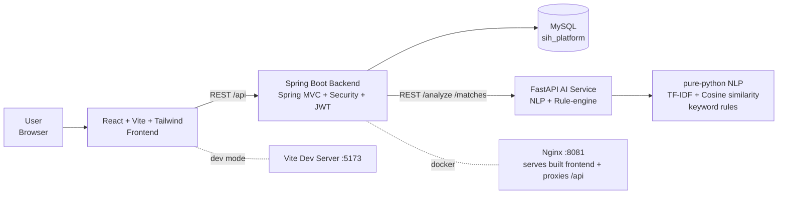

# Societal Innovation Collaboration Platform

**Smart India Hackathon 2026 — Problem Statement SIH26043**

> A Digital Platform to Crowdsource Societal Challenges and Facilitate Collaborative Problem Solving Through Universities and Industry Partnerships.

---

## Problem Overview

Citizens, communities and organisations constantly face real societal problems — waste management, water quality, public health, education and more — but there is **no structured pipeline** that connects a verified problem with the universities, student teams, faculty mentors and industry partners who can actually **solve and implement** it.

Problems get lost in unstructured posts; solutions are built in silos; and impact is never verified or measured. This prototype builds that missing pipeline.

## Solution

A web-based **working prototype** that takes a citizen-reported societal problem and runs it through an intelligent, implementation-focused ecosystem:

```
Society / Citizens
        │
        ▼
Real Societal Problems ─────────────► Verified + de-duplicated challenges
        │
        ▼
AI Problem Intelligence ─────────────► category, urgency, skills, keywords, explanation
        │
        ▼
Capability Decomposition ────────────► the problem split into buildable capabilities
        │
        ▼
University / Student / Faculty / Industry Matching (explainable)
        │
        ▼
Multi-stakeholder Collaboration ──────► recommended combination
        │
        ▼
Project Workspace + Lifecycle ────────► SUBMITTED → ... → IMPLEMENTATION → IMPACT
        │
        ▼
Failure Recovery / Re-matching ───────► failed pilot → missing capability → new collaborator
        │
        ▼
Verified Social Impact ───────────────► evidence-backed beneficiary statistics
```

The differentiator is **not** any single feature — it is the **combination and workflow**: from problem to verified impact with explainable matching, structured lifecycle and failure recovery, all in one platform.

## Key Features

| Area | Feature |
|------|---------|
| Problem Intake | Citizens submit societal challenges with location, urgency, beneficiaries, required outcome |
| AI Intelligence | Free/open-source NLP engine classifies category, urgency, required skills, keywords with an **explanation** |
| De-duplication | TF-IDF + cosine similarity detects similar challenges (e.g. “Potential similar challenge found — 91%”) |
| Capability Decomposition | A broad problem is split into smaller buildable capabilities with required skills |
| University Matching | Problems matched to universities by departments, research areas, labs and technologies (explainable %) |
| Student Team Matching | Teams matched by skills, technologies, interests, projects, availability |
| Faculty Matching | Mentors matched by expertise, research area and background |
| Industry Matching | Partners matched by expertise, hardware, funding/CSR, mentorship, testing, deployment |
| Multi-stakeholder Combination | Recommends *University + Student Team + Mentor + Industry Partner* together with contributions |
| Project Workspace | Overview, members, tasks, milestones, comments, files, mentor/industry feedback |
| Project Lifecycle | SUBMITTED → VERIFIED → MATCHED → TEAM_FORMED → PROPOSAL → PROTOTYPE → REVIEW → PILOT → IMPLEMENTATION → IMPACT (visual timeline) |
| Failure Recovery | If a pilot fails, the system detects the missing capability and recommends new collaborators (project is never permanently failed) |
| Implementation Tracking | Progress percentage for prototype, review, pilot and implementation stages |
| Social Impact | Records beneficiaries, locations, cost savings, problem reduction, domain metrics |
| Evidence Verification | Impact claims only count after PENDING → PARTIALLY_VERIFIED → VERIFIED with uploaded evidence |
| Role-based Dashboards | Citizen, Student, Faculty, University Admin, Industry, Government Admin, Platform Admin |
| Analytics | Challenges by category/status, university/industry participation, implementation rate, social impact charts |

## Architecture



- **Frontend** (React + Vite + Tailwind) — role dashboards, problem submission, AI analysis, matching, project workspace, impact.
- **Backend** (Spring Boot, Java 25+) — REST APIs, JWT auth, role-based authorization, business logic, MySQL persistence via Spring Data JPA.
- **AI Service** (FastAPI, Python, free/open-source only) — problem classification, capability decomposition, duplicate detection, all matching engines, failure recovery. **No paid API required.**
- **Database** (MySQL 8) — normalized schema, seeded with realistic demo data.

The AI service is deliberately **stateless**: the backend owns the data and sends scoring requests. If the AI service is unavailable, the backend automatically falls back to a built-in lightweight rule engine (`AI_ENABLED=false`) so the demo never breaks.

## Tech Stack

| Layer | Technology |
|-------|------------|
| Frontend | React 18, Vite, Tailwind CSS, Recharts, React Router |
| Backend | Java 25+, Spring Boot 3, Spring MVC, Spring Security, JWT (jjwt), Spring Data JPA |
| AI | Python 3, FastAPI, Uvicorn, pure-Python TF-IDF + cosine similarity NLP, rule-based matching |
| Database | MySQL 8 |
| Infra | Docker / Docker Compose, Git, GitHub |

## Repository Structure

```
sih26043-societal-innovation-platform/
│
├── frontend/          React + Vite + Tailwind SPA
├── backend/           Spring Boot REST API
├── ai-service/        FastAPI NLP / matching engine
├── database/          schema.sql + seed.sql reference
├── docs/              architecture.md · api.md · database.md · demo-flow.md
├── docker-compose.yml one-command full stack
├── .env.example       environment template (never commit real .env)
├── README.md
└── CONTRIBUTING.md
```

> Note: in this working copy the repo root is the folder `setu`; the canonical repo name is `sih26043-societal-innovation-platform`.

## Screenshots

*(Add screenshots of the dashboards, challenge analysis and lifecycle views here before submitting.)*

## Installation

### Option A — Docker Compose (recommended, one command)

```bash
cp .env.example .env          # edit if needed (defaults work out-of-the-box)
docker compose up --build
```

Then open **http://localhost:8081** (frontend) and **http://localhost:8080/api** (backend).

### Option B — Run locally (for development)

Prerequisites: Java 25+, Maven (or use `./mvnw`), Node 18+, Python 3.10+, MySQL 8.

```bash
# 1) Database: create schema
mysql -u root -p < database/schema.sql

# 2) AI service
cd ai-service
python -m venv .venv && .venv\Scripts\activate   # or source .venv/bin/activate
pip install -r requirements.txt
uvicorn app.main:app --port 8000 --reload

# 3) Backend
cd backend
cp ../.env.example ../.env
# edit .env if your MySQL/credentials differ
set SPRING_PROFILES_ACTIVE=dev        # Windows  |  export SPRING_PROFILES_ACTIVE=dev (Mac/Linux)
set DB_URL=jdbc:mysql://localhost:3306/sih_platform?useSSL=false&serverTimezone=UTC
set DB_USERNAME=root
set DB_PASSWORD=your_password
mvn spring-boot:run

# 4) Frontend
cd frontend
npm install
npm run dev        # http://localhost:5173
```

The backend seeds demo data automatically on first startup (empty database).

## Environment Variables

All runtime configuration is via environment variables (`.env`), never hard-coded.

| Variable | Default | Purpose |
|----------|---------|---------|
| `MYSQL_DATABASE` | `sih_platform` | Database name |
| `MYSQL_USER` / `MYSQL_PASSWORD` | `sih` / `sih_password` | DB credentials |
| `MYSQL_ROOT_PASSWORD` | `root_password` | DB root password (docker) |
| `DB_URL` | `jdbc:mysql://mysql:3306/sih_platform...` | JDBC URL |
| `DB_USERNAME` / `DB_PASSWORD` | `sih` / `sih_password` | Backend DB login |
| `JWT_SECRET` | dev value | JWT signing secret (min 32 chars) |
| `JWT_EXPIRATION_MS` | `86400000` | Token lifetime |
| `AI_SERVICE_URL` | `http://ai-service:8000` | AI service base URL |
| `AI_ENABLED` | `true` | Use AI service; `false` → Java fallback engine |
| `FRONTEND_ORIGIN` | `http://localhost:8081` | Allowed CORS origin |
| `SPRING_PROFILES_ACTIVE` | `docker` | Spring profile |

## Database Setup

- Schema: `database/schema.sql` (25+ normalized tables with FKs).
- Demo data: inserted automatically by the backend seeder when the DB is empty (10 problems, 5 universities, 10 faculty, 5 teams, 5 industries, 10 projects, matches, milestones, 2 failed pilots, 3+ implemented projects, impact records).
- A standalone reference dump lives in `database/seed.sql`.
- Design notes: `docs/database.md`.

## AI Service Setup

```bash
cd ai-service
pip install -r requirements.txt
uvicorn app.main:app --port 8000
```

Endpoints: `/health`, `/analyze`, `/decompose`, `/duplicates`, `/match/university`, `/match/team`, `/match/mentor`, `/match/industry`, `/recommend`, `/recovery`. Full NLP explainability — every result includes human-readable reasons.

## Running

Interactive demo flow: see `docs/demo-flow.md` (also reproducible in the UI as a complete end-to-end story: waste-collection problem → AI → matches → project → failed pilot → recovery → implementation → verified impact).

## Demo Credentials (seeded)

| Role | Email | Password |
|------|-------|----------|
| Citizen | `citizen@example.com` | `password123` |
| Student | `student@example.com` | `password123` |
| Faculty | `faculty@example.com` | `password123` |
| University Admin | `university@example.com` | `password123` |
| Industry | `industry@example.com` | `password123` |
| Government Admin | `government@example.com` | `password123` |
| Platform Admin | `admin@example.com` | `password123` |

## API Documentation

REST API spec and examples: `docs/api.md`. A ready-to-import Postman collection is generated at `docs/postman/sih26043.postman_collection.json` (manual import option). Core resources:

```
POST   /api/auth/register
POST   /api/auth/login
POST   /api/problems
GET    /api/problems
GET    /api/problems/{id}
POST   /api/problems/{id}/analyze
POST   /api/problems/{id}/duplicates
GET    /api/problems/{id}/matches
GET    /api/universities
GET    /api/student-teams
GET    /api/faculty
GET    /api/industries
POST   /api/problems/{id}/recommend
POST   /api/projects
GET    /api/projects/{id}
PUT    /api/projects/{id}/status
POST   /api/projects/{id}/tasks
POST   /api/projects/{id}/milestones
POST   /api/projects/{id}/comments
POST   /api/projects/{id}/documents
POST   /api/projects/{id}/failure
GET    /api/projects/{id}/recovery-recommendations
POST   /api/projects/{id}/impact
POST   /api/projects/{id}/impact/evidence
GET    /api/dashboard/{scope}
```

## Team Contribution Guide

See `CONTRIBUTING.md` — branch naming, commit message style, PR workflow.

## Future Scope

- Real-time chat / collaboration notifications
- Live mapping of problems and impact locations
- Production-grade ML models (LLM classifiers, embedding-based matching) plugged into the existing AI interface
- File/object storage for documents and evidence
- Email/SMS notifications
- Mobile-first PWA
- Native language support (Indian languages) for citizen submissions

---

*Built as an MVP prototype for Smart India Hackathon 2026 (SIH26043). All services are free and open-source; no paid API or database is required.*