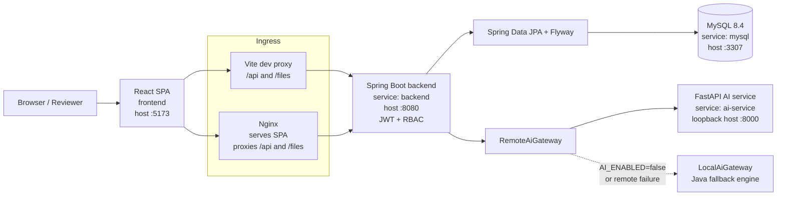

# SETU — Societal Innovation Collaboration Platform

**Smart India Hackathon 2026 · Problem Statement SIH26043**

**GrowthX Off Campus code: `N4Q268`**

> SETU is a working prototype that converts citizen-reported societal challenges into verified, evidence-backed impact through explainable problem analysis, stakeholder matching, collaborative project execution, failure recovery and impact verification.

This repository contains a runnable full-stack prototype: React SPA, Spring Boot REST API, MySQL with Flyway migrations and a deterministic FastAPI analysis service. It is designed for local demonstration and review; no public deployment is claimed.

## Table of Contents

- [SIH 2026 Problem Statement](#sih-2026-problem-statement)
- [Problem and Proposed Solution](#problem-and-proposed-solution)
- [Key Differentiators](#key-differentiators)
- [Genuine Application Screenshots](#genuine-application-screenshots)
- [Architecture](#architecture)
- [Technology Stack](#technology-stack)
- [Key Features](#key-features)
- [Repository Layout](#repository-layout)
- [Installation and Setup](#installation-and-setup)
- [Demo Credentials](#demo-credentials)
- [Demo Walkthrough](#demo-walkthrough)
- [API Documentation](#api-documentation)
- [Testing and Verification](#testing-and-verification)
- [Known Limitations](#known-limitations)
- [Future Scope](#future-scope)
- [Contributing](#contributing)

## SIH 2026 Problem Statement

> **A Digital Platform to Crowdsource Societal Challenges and Facilitate Collaborative Problem Solving Through Universities and Industry Partnerships.**

SETU addresses the missing structured pipeline between real societal problems and the people who can solve them. Citizens, communities and organisations can submit challenges; the platform analyses and decomposes them, ranks similar work, recommends university, student, faculty and industry collaborators, tracks the resulting project lifecycle, handles failed pilots and verifies final social impact.

## Problem and Proposed Solution

### The problem

Societal challenges are often posted as unstructured complaints or one-off requests. They rarely reach the right universities, teams, mentors or industry partners in a reusable form. Even when a solution is built, progress and impact are rarely visible, comparable or evidence-backed.

### The proposed solution

SETU turns that unstructured intake into an implementation pipeline:

```text
Citizen-reported challenge
        ↓
Problem analysis: category, urgency, skills, keywords and explanation
        ↓
Duplicate ranking and capability decomposition
        ↓
Explainable university, student-team, faculty and industry matching
        ↓
Multi-stakeholder recommendation
        ↓
Project workspace and lifecycle tracking
        ↓
Failure recovery and re-matching when a pilot is blocked
        ↓
Evidence-reviewed social impact records
```

The AI service is deterministic and rule-based. It uses keyword rules plus TF-IDF-weighted cosine similarity for duplicate ranking. It is **not** a trained ML model, generative model or paid external API. When the remote AI service is disabled or unavailable, the backend uses its built-in Java fallback engine so the demo can continue.

## Key Differentiators

| Differentiator | What the prototype demonstrates |
|---|---|
| End-to-end chain | One workflow covers intake, analysis, matching, project execution, recovery and impact verification. |
| Explainable analysis | Category analysis includes a human-readable explanation. |
| Capability decomposition | A broad challenge is split into buildable capabilities with required skills and priority. |
| Multi-stakeholder recommendation | Recommends a university, student team, mentor and industry partner together, including gap skills. |
| Failure recovery | A failed pilot records the missing capability and recommends collaborators who can close that gap. |
| Evidence-backed impact | Impact claims are reviewed before they affect analytics counters. |
| Review-ready local stack | Docker Compose starts all services in dependency order with healthchecks and repeatable demo scenario data. |

These are prototype-level implementations intended for an SIH demonstration, not production deployments.

## Genuine Application Screenshots

1. **Landing page**

   .png>)

2. **Dashboard**

   .png>)

3. **Challenges**

   .png>)

4. **Matching**

   .png>)

5. **Impact**

   .png>)

6. **Capabilities**

   .png>)

7. **Catalog**

   .png>)

## Architecture



### Verified ports and Compose services

| Compose service | Container | Host address | Purpose |
|---|---|---|---|
| `frontend` | `sih_frontend` | `http://localhost:5173` | Built React SPA served by Nginx |
| `backend` | `sih_backend` | `http://localhost:8080` | REST API; health at `/api/health` and `/actuator/health` |
| `mysql` | `sih_mysql` | host port `3307` | MySQL 8.4 database; container port `3306` |
| `ai-service` | `sih_ai_service` | `http://127.0.0.1:8000` | FastAPI analysis service; loopback only; interactive docs at `/docs` |

In development, Vite proxies `/api` and `/files` to `http://localhost:8080`. In Docker, Nginx serves the built SPA and proxies `/api` and `/files` to `http://backend:8080`. The backend talks to MySQL as `mysql:3306` and to the AI service as `ai-service:8000` on the Compose network.

### Runtime flow

1. The SPA calls `POST /api/auth/login`; the backend returns a JWT and user summary.
2. Protected API calls send `Authorization: Bearer <token>`.
3. The backend enforces authentication and role/service-level authorization, then persists domain data in MySQL.
4. For analysis, decomposition, duplicate ranking and recommendations, the backend sends only the required payload to the AI service.
5. AI responses include a `source` marker. Backend-to-AI integration was verified with `aiSource=REMOTE`.
6. Remote failure or `AI_ENABLED=false` selects the Java fallback engine, keeping the local demo functional.

### Documentation map

Detailed documentation is linked below. Some older report files describe an earlier verification state; use the [Testing and Verification](#testing-and-verification) section of this README for the current verified summary.

| Document | Purpose |
|---|---|
| [Architecture](docs/architecture.md) | Ports, component responsibilities, data flow, AI integration and security boundary |
| [API documentation](docs/API_DOCUMENTATION.md) | Endpoint, payload and authorization reference |
| [Database](docs/database.md) | 24-table schema, Flyway migrations, constraints and seeding details |
| [Testing](docs/TESTING.md) | Test commands, coverage and historical caveats |
| [Demo flow](docs/demo-flow.md) | Full end-to-end scenario and seeded stories |
| [Implementation audit](docs/IMPLEMENTATION_AUDIT.md) | Module-by-module implementation notes |
| [Release readiness report](docs/RELEASE_READINESS_REPORT.md) | Earlier release review and security notes |
| [Final project report](docs/FINAL_PROJECT_REPORT.md) | Project narrative and report material |
| [API notes](docs/api.md) | Older API notes |

## Technology Stack

| Layer | Technology |
|---|---|
| Frontend | React 18.3, Vite 5.4, React Router 6.30, Tailwind CSS 3.4, Recharts 2.15 |
| Backend | Java 25, Spring Boot 3.5.4, Spring MVC, Spring Security, JJWT 0.12.6, Spring Data JPA, Bean Validation, Actuator |
| Database and migrations | MySQL 8.4, Flyway Core and Flyway MySQL |
| AI service | Python 3.12, FastAPI 0.115.12, Uvicorn 0.34.3, Pydantic 2, deterministic rules, TF-IDF and cosine similarity |
| Testing | JUnit, Spring Security tests, pytest, Node test runner, Vitest and React Testing Library |
| Infrastructure | Docker, Docker Compose v2, Nginx 1.27, GitHub Actions CI workflow |

## Key Features

| Area | Capability |
|---|---|
| Problem intake | Citizens submit societal challenges with title, description, location, urgency, beneficiaries, outcome and optional document URL. |
| Problem intelligence | Deterministic rules classify category and urgency, extract skills/keywords and return a plain-language explanation. |
| Duplicate detection | TF-IDF-weighted cosine similarity ranks similar challenges. |
| Capability decomposition | A challenge is split into buildable capabilities with required skills and priority. |
| Stakeholder matching | Universities, student teams, faculty mentors and industry partners receive explainable relevance scores. |
| Recommendation | The strongest stakeholder per type is recommended with contribution and gap skills. |
| Project workspace | Tasks, milestones, comments, document URLs, progress, status history and members. |
| Project lifecycle | `SUBMITTED → VERIFIED → MATCHED → TEAM_FORMED → PROPOSAL → PROTOTYPE → REVIEW → PILOT → IMPLEMENTATION → IMPACT`. |
| Failure recovery | Failed pilots record a missing capability and receive recovery recommendations. |
| Impact verification | Evidence starts `PENDING`; admin review moves it to `VERIFIED` or `REJECTED`, and analytics count verified records. |
| Role-based access | Citizen, Student, Faculty, University Admin, Industry, Government Admin and Platform Admin roles. |
| Analytics | Category/status charts, participation, implementation rate and social-impact statistics. |

## Repository Layout

```text
.
├── .env.example
├── .github/workflows/ci.yml
├── ai-service/
│   ├── app/                  main.py, engine.py, knowledge.py
│   ├── tests/                endpoint, validation, edge-case and engine tests
│   ├── Dockerfile
│   └── requirements.txt
├── backend/
│   ├── mvnw / mvnw.cmd
│   ├── pom.xml
│   ├── Dockerfile
│   └── src/main/
│       ├── java/com/sih/innovationplatform/
│       └── resources/
│           ├── application.yml
│           └── db/migration/V1__baseline.sql, V2__harden_schema.sql
├── database/schema.sql       legacy reference; not mounted by Compose
├── docs/                     architecture, API, database, testing and report files
├── frontend/
│   ├── src/
│   ├── Dockerfile, nginx.conf
│   ├── vite.config.js, vitest.config.js, eslint.config.js
│   └── package.json, package-lock.json
├── docker-compose.yml
├── CONTRIBUTING.md
└── README.md
```

Flyway migrations under `backend/src/main/resources/db/migration/` are the schema source of truth. `database/schema.sql` is a legacy reference and is not mounted by Compose.

## Installation and Setup

### Option A — Docker Compose (recommended)

Prerequisites: Docker Engine with the Compose v2 plugin.

```bash
cp .env.example .env
docker compose up --build
docker compose ps
```

Open <http://localhost:5173>. The `.env` file contains local demo values only; never commit it.

| Endpoint | Address |
|---|---|
| Frontend | <http://localhost:5173> |
| Backend API | <http://localhost:8080/api> |
| Backend health | <http://localhost:8080/api/health> |
| Backend actuator health | <http://localhost:8080/actuator/health> |
| AI health | <http://127.0.0.1:8000/health> |
| AI interactive docs | <http://127.0.0.1:8000/docs> |
| MySQL | host port `3307`, container port `3306` |

Compose startup behaviour:

- MySQL healthcheck uses `mysqladmin ping`.
- AI healthcheck calls `GET /health`.
- Backend waits for MySQL and AI to be healthy, applies Flyway migrations, runs the conditional Java seeder and exposes `GET /api/health`.
- Frontend waits until the backend is healthy, then Nginx serves the built SPA on host port `5173`.
- Demo seeding runs only when `APP_SEED_ENABLED=true` and core tables are empty.

Stop the stack with:

```bash
docker compose down
```

Use `docker compose down -v` only when you intentionally want to delete the persisted MySQL volume.

### Option B — Local development

Prerequisites: Java 25, Maven Wrapper, Node 20+, Python 3.12+ and MySQL 8.4. No paid API or external model is required.

1. Start MySQL 8.4 with an empty `sih_platform` schema. To use the Compose database only, run:

   ```bash
   docker compose up -d mysql
   ```

2. Start the AI service in one terminal:

   ```powershell
   cd ai-service
   py -3.12 -m venv .venv
   .\.venv\Scripts\python.exe -m pip install -r requirements.txt
   .\.venv\Scripts\python.exe -m uvicorn app.main:app --host 127.0.0.1 --port 8000
   ```

3. Start the backend in another terminal. The values below use the Compose MySQL published on host port `3307`:

   ```powershell
   cd backend
   $env:DB_URL = "jdbc:mysql://127.0.0.1:3307/sih_platform?useSSL=false&allowPublicKeyRetrieval=true&serverTimezone=UTC"
   $env:DB_USERNAME = "sih"
   $env:DB_PASSWORD = "sih_password"
   $env:JWT_SECRET = "dev-secret-change-me-please-32-characters-minimum"
   $env:JWT_ALLOW_DEV_SECRET = "true"
   $env:JWT_EXPIRATION_MS = "86400000"
   $env:APP_SEED_ENABLED = "true"
   $env:AI_SERVICE_URL = "http://127.0.0.1:8000"
   $env:AI_ENABLED = "true"
   $env:FRONTEND_ORIGIN = "http://localhost:5173"
   .\mvnw.cmd spring-boot:run
   ```

4. Start the frontend in a third terminal:

   ```bash
   cd frontend
   npm ci
   npm run dev
   ```

The Vite dev server listens on <http://localhost:5173> and proxies `/api` and `/files` to `http://localhost:8080`. Runtime configuration comes from environment variables; there is no Spring profile-specific configuration.

### Environment variables

The following values are local examples from `.env.example`. Change database passwords and `JWT_SECRET` for any non-local use.

| Variable | Local example | Purpose |
|---|---|---|
| `MYSQL_DATABASE` | `sih_platform` | Compose MySQL database name |
| `MYSQL_USER` | `sih` | Compose MySQL application user |
| `MYSQL_PASSWORD` | `sih_password` | Compose MySQL application password |
| `MYSQL_ROOT_PASSWORD` | `root_password` | Compose MySQL root password |
| `DB_URL` | `jdbc:mysql://mysql:3306/sih_platform?...` | Backend JDBC URL |
| `DB_USERNAME` | `sih` | Backend database user |
| `DB_PASSWORD` | `sih_password` | Backend database password |
| `JWT_SECRET` | `dev-secret-change-me-please-32-characters-minimum` | Development JWT signing secret |
| `JWT_ALLOW_DEV_SECRET` | `true` | Allows the bundled development secret |
| `JWT_EXPIRATION_MS` | `86400000` | Token lifetime in milliseconds |
| `APP_SEED_ENABLED` | `true` | Enables repeatable demo seeding on an empty database |
| `AI_SERVICE_URL` | `http://ai-service:8000` | Remote AI service base URL |
| `AI_ENABLED` | `true` | `true` uses the FastAPI service; `false` selects the Java fallback engine |
| `FRONTEND_ORIGIN` | `http://localhost:5173` | Allowed CORS origin |

## Demo Credentials

**Local demonstration only.** These accounts are seeded when `APP_SEED_ENABLED=true` and the core tables are empty. They are not production credentials and must not be used outside this local prototype.

All seeded demo accounts use password: `password123`.

| Role | Email |
|---|---|
| Citizen | `citizen@example.com` |
| Student | `student@example.com` |
| Faculty | `faculty@example.com` |
| University Admin | `university@example.com` |
| Industry | `industry@example.com` |
| Government Admin | `government@example.com` |
| Platform Admin | `admin@example.com` |

## Demo Walkthrough

A time-boxed demo should follow the rural waste-collection scenario. An older narrative draft is in [docs/demo-flow.md](docs/demo-flow.md); use this walkthrough and the source seeder for current details.

1. **Open the dashboard.** Start the stack, open <http://localhost:5173> and show the seeded challenge, project and impact counts.
2. **Submit a challenge.** Log in as `citizen@example.com`, choose **Challenges → Submit Challenge** and enter:
   - Title: **Poor waste collection and monitoring in rural area**
   - Description: **Waste collection is irregular and there is no tracking mechanism; garbage is piling up at village collection points.**
   - Location: **Hosur, Tamil Nadu**
   - Beneficiaries: `8000`
   - Urgency: `HIGH`
3. **Show AI analysis.** Open the challenge detail page. The backend calls `POST /api/problems/{id}/analyze`; show category, urgency, required skills, keywords, explanation and structured analysis fields.
4. **Show decomposition and duplicates.** Point out the buildable capabilities and any similarly ranked challenge. Explain that scores are deterministic TF-IDF/cosine similarity results, not generative output.
5. **Verify and match.** Log in as an admin/government user, verify the challenge and run matching. Show explainable scores for a university, student team, mentor and industry partner, then show the combined recommendation with gap skills.
6. **Show the project workspace.** Create the project and walk through tasks, milestones, comments, documents, members and progress.
7. **Walk the lifecycle.** Move forward from the created or seeded project's current status through later stages to `PILOT` and show the status timeline.
8. **Demonstrate failure recovery.** Report a failed pilot with reason **GIS expertise missing**. Show that the project enters `NEEDS_SUPPORT`, then inspect recovery recommendations for collaborators who close that capability gap.
9. **Return to implementation.** Continue the recovered project through `PILOT → IMPLEMENTATION`; implementation maps to `75%` progress, and `IMPACT` maps to `100%`.
10. **Verify impact.** Submit impact with beneficiaries, villages, cost savings and reduction figures, add evidence, then review as Platform Admin and show that analytics count only verified impact records.

The seeded dataset also includes water quality, rural broadband, flood early-warning and agricultural price-transparency stories for alternate demos.

## API Documentation

Full endpoint, payload and authorization details are in [docs/API_DOCUMENTATION.md](docs/API_DOCUMENTATION.md). The FastAPI service provides interactive documentation at <http://127.0.0.1:8000/docs>.

Backend base URL: <http://localhost:8080>. Most routes are under `/api`.

Authentication:

```text
Authorization: Bearer <jwt>
```

Public backend routes include `POST /api/auth/register`, `POST /api/auth/login`, `GET /api/health` and `GET /health`. All other API routes require a JWT; specific mutations also enforce role, ownership or membership checks. A citizen accessing an admin-only route was verified to receive HTTP `403`.

| Resource group | Representative endpoints |
|---|---|
| Auth | `POST /api/auth/register`, `POST /api/auth/login`, `GET /api/auth/me` |
| Problems | `GET /api/problems`, `POST /api/problems`, `GET /api/problems/{id}`, `POST /api/problems/{id}/analyze`, `GET /api/problems/{id}/capabilities` |
| Matching | `POST /api/problems/{id}/match`, `GET /api/problems/{id}/matches`, `POST /api/problems/{id}/recommend`, `GET /api/problems/{id}/recovery-recommendations` |
| Catalog | `GET /api/universities`, `GET /api/student-teams`, `GET /api/faculty`, `GET /api/industries` |
| Projects | `POST /api/projects`, `GET /api/projects/{id}`, `PUT /api/projects/{id}/status`, tasks, milestones, comments, documents, progress, failure and recovery routes |
| Impact | `GET /api/projects/{id}/impact`, `POST /api/projects/{id}/impact`, `POST /api/projects/{id}/impact/evidence`, `PUT /api/impact/evidence/{evidenceId}/review`, `GET /api/impact/stats` |
| Notifications and dashboard | `GET /api/notifications`, `POST /api/notifications/{id}/read`, `GET /api/dashboard/analytics`, `GET /api/dashboard/me` |
| Health | `GET /api/health`, `GET /health`, `GET /actuator/health`, AI `GET /health` |

## Testing and Verification

Current verified results as of `2026-11-22`:

| Area | Verified result |
|---|---|
| Backend | Maven tests: `69 passed`, zero failures, zero errors |
| AI service | pytest: `77 passed` |
| Frontend | `18 Node tests passed`; prior `npm run lint` and `npm run build` checks passed |
| Docker | Images built successfully; all four Docker Compose services verified running/healthy |
| Backend health | `GET /api/health` returned HTTP `200`; actuator health returned HTTP `200` |
| AI health | `GET /health` returned HTTP `200` with `{"status":"ok"}` |
| AI endpoint | `POST /analyze` returned HTTP `200` with structured analysis |
| Backend-to-AI integration | Verified with `aiSource=REMOTE` |
| Authentication and RBAC | Login, JWT access and role checks verified; citizen access to an admin-only route returned HTTP `403` |
| Problem re-analysis | Reverified after the capability flush fix; HTTP `200` |
| Capabilities endpoint | Reverified after the entity serialization fix; HTTP `200`, 4 capabilities |
| Source control | GitHub `main` synchronized at commit `43573a9` |
| Deployment | No public deployment performed |

Reproduce the main checks with:

```bash
# Backend
cd backend && ./mvnw test

# AI service
cd ai-service && python -m pytest -q

# Frontend
cd frontend && npm run lint && npm test && npm run build

# Docker Compose
cd .. && docker compose config && docker compose up --build
```

> On Windows, use `.\mvnw.cmd test` for the backend command. If the host JVM cannot start because of local memory/configuration limits, run the backend tests in a Java 25 Maven container.

The GitHub Actions workflow in `.github/workflows/ci.yml` runs backend tests, AI tests, frontend lint/tests/build and `docker compose config`. The workflow exists, but a remote GitHub run has not been verified.

## Known Limitations

- This is a prototype for demonstration, not a production-hardened system.
- The AI engine is deterministic and rule-based; it is not trained ML or generative AI, and scores are heuristics rather than validated predictions.
- Demo accounts, default database passwords and the development JWT secret are local-only. There is no secret manager, email verification, password reset, token revocation or refresh flow.
- Tokens are stored in browser `localStorage`.
- Documents and evidence use URLs/metadata; there is no real object storage or upload pipeline.
- No email/SMS delivery, real-time chat or public deployment is implemented.
- Screenshot coverage is limited to the seven pages shown above; capture additional flows from the running stack before final submission if required.
- The GitHub Actions workflow has not been verified through a remote run.
- npm audit findings and the existing frontend chunk-size warning remain; no forced dependency upgrade was applied.
- Some historical report files under `docs/` predate the final runtime verification reflected in this README.

## Future Scope

- Real-time collaboration, chat and richer notification delivery.
- Live maps for problem locations, project coverage and verified impact.
- Production-grade models behind the existing AI gateway, with an evaluation and bias-review harness.
- Object storage, file validation and preview support for documents and evidence.
- Production identity features: refresh tokens, revocation, MFA, email verification and password reset.
- Mobile-first PWA and native-language submission support.
- Deployment automation, observability, backup/restore and production migration procedures.

## Contributing

See [CONTRIBUTING.md](CONTRIBUTING.md) for module ownership, branch naming, commit style and PR workflow.

- Use focused `feature/*` or `fix/*` branches.
- Use conventional commit prefixes such as `feat:`, `fix:`, `docs:`, `test:` and `chore:`.
- Run the relevant backend, AI and frontend tests before opening a PR.
- Never commit `.env`, real secrets or generated build output.
- Describe verification steps and include genuine screenshots when the change is visible in the UI.
