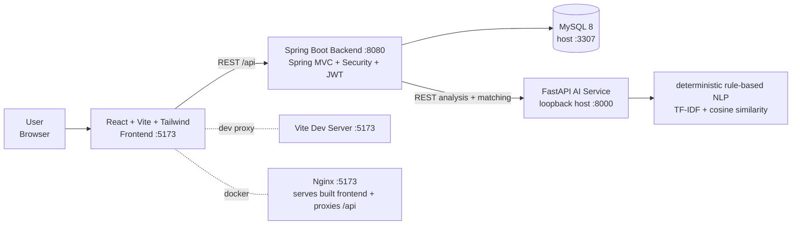

# Societal Innovation Collaboration Platform

**Smart India Hackathon 2026 — Problem Statement SIH26043**

> A Digital Platform to Crowdsource Societal Challenges and Facilitate Collaborative Problem Solving Through Universities and Industry Partnerships.

---

## Problem Overview

Citizens, communities and organisations constantly face real societal problems — waste management, water quality, public health, education and more — but there is **no structured pipeline** that connects a verified problem with the universities, student teams, faculty mentors and industry partners who can actually **solve and implement** it.

Problems get lost in unstructured posts; solutions are built in silos; and impact is never verified or measured. This prototype builds that missing pipeline.

## Solution

A web-based **working prototype** that takes a citizen-reported societal problem and runs it through an intelligent, implementation-focused ecosystem:

```
Society / Citizens
        │
        ▼
Real Societal Problems ─────────────► Verified challenges
        │
        ▼
AI Problem Intelligence ────────────► category, urgency, skills, keywords, explanation
        │
        ▼
Capability Decomposition ───────────► the problem split into buildable capabilities
        │
        ▼
University / Student / Faculty / Industry Matching (explainable)
        │
        ▼
Multi-stakeholder Collaboration ────► recommended combination
        │
        ▼
Project Workspace + Lifecycle ──────► SUBMITTED → ... → IMPLEMENTATION → IMPACT
        │
        ▼
Failure Recovery / Re-matching ─────► failed pilot → missing capability → new collaborator
        │
        ▼
Verified Social Impact ─────────────► evidence-backed beneficiary statistics
```

The differentiator is **the combination and workflow**: from problem intake to verified impact with explainable matching, a structured lifecycle and failure recovery, all in one platform.

## Key Features

| Area | Feature |
|------|---------|
| Problem Intake | Citizens submit societal challenges with location, urgency, beneficiaries, required outcome and optional document URL |
| AI Intelligence | Deterministic rule-based NLP classifies category, urgency, required skills, keywords and explanation; returns structured analysis fields |
| De-duplication | TF-IDF + cosine similarity ranks similar challenges |
| Capability Decomposition | A broad problem is split into smaller buildable capabilities with required skills and priority |
| University Matching | Problems matched to universities by departments, research areas, labs and technologies (explainable score) |
| Student Team Matching | Teams matched by skills, technologies, interests, projects and availability |
| Faculty Matching | Mentors matched by expertise, research area and background |
| Industry Matching | Partners matched by expertise, hardware, funding/CSR, mentorship, testing and deployment capability |
| Multi-stakeholder Combination | Recommends *University + Student Team + Mentor + Industry Partner* together with contributions and gap skills |
| Project Workspace | Tasks, milestones, comments, document URLs, progress, status history, failure records and recovery recommendations |
| Project Lifecycle | SUBMITTED → VERIFIED → MATCHED → TEAM_FORMED → PROPOSAL → PROTOTYPE → REVIEW → PILOT → IMPLEMENTATION → IMPACT |
| Failure Recovery | A failed pilot records the missing capability and recommends collaborators who can close the gap |
| Implementation Tracking | Progress percentage and stage history for prototype, review, pilot and implementation stages |
| Social Impact | Records beneficiaries, locations, cost savings, problem reduction and domain metrics |
| Evidence Verification | Impact claims move PENDING → PARTIALLY_VERIFIED → VERIFIED after admin evidence review |
| Role-based Access | Citizen, Student, Faculty, University Admin, Industry, Government Admin and Platform Admin roles |
| Analytics | Challenges by category/status, participation, implementation rate and social impact statistics |

## Architecture



- **Frontend** (React 18, Vite 5, Tailwind CSS 3) — role-aware pages, problem submission, AI analysis, matching, project workspace and impact.
- **Backend** (Spring Boot 3.5.4, Java 25) — REST APIs, JWT auth, role checks, business logic, MySQL persistence via Spring Data JPA and schema migrations via Flyway.
- **AI Service** (FastAPI, Python 3.12) — deterministic keyword/TF-vector analysis, decomposition, duplicate ranking, matching, recommendations and recovery suggestions. **No paid API required.**
- **Database** (MySQL 8.4) — 24-table schema managed by Flyway V1/V2, with a property-gated Java demo seeder.
- **Ingress** — in development Vite proxies `/api` to `localhost:8080`; in Docker Nginx serves the built SPA and proxies `/api` to `backend:8080`. The AI service is published only on `127.0.0.1:8000`.

The AI service is stateless: the backend owns the data and sends scoring requests. `AI_ENABLED=false` selects the built-in Java fallback engine; remote AI failures are logged and fall back to that engine. No trained ML model is used. See `docs/ARCHITECTURE.md`.

## Tech Stack

| Layer | Technology |
|-------|------------|
| Frontend | React 18, Vite 5, React Router 6, Tailwind CSS 3, Recharts 2, Vitest 2 |
| Backend | Java 25, Spring Boot 3.5.4, Spring MVC, Spring Security, JJWT, Spring Data JPA, Flyway, Bean Validation |
| AI | Python 3.12, FastAPI 0.115.12, Uvicorn 0.34.3, Pydantic 2, deterministic rules, TF-IDF + cosine similarity |
| Database | MySQL 8.4 |
| Infra | Docker / Docker Compose, Nginx 1.27, GitHub Actions workflow |

## Repository Structure

```
setu/
├── .env.example
├── .github/workflows/ci.yml
├── ai-service/
│   ├── app/          main.py · engine.py · knowledge.py
│   ├── tests/        AI endpoint, validation, edge-case and engine tests
│   ├── Dockerfile
│   └── requirements.txt
├── backend/
│   ├── mvnw / mvnw.cmd
│   ├── pom.xml
│   ├── Dockerfile
│   └── src/main/
│       ├── java/com/sih/innovationplatform/   controllers · services · security · config
│       └── resources/
│           ├── application.yml
│           └── db/migration/V1__baseline.sql · V2__harden_schema.sql
├── backend/src/test/java/                     JUnit / Spring Security tests
├── database/schema.sql                         legacy reference SQL, not mounted by Compose
├── docs/
│   ├── ARCHITECTURE.md · API_DOCUMENTATION.md · DATABASE.md
│   ├── IMPLEMENTATION_AUDIT.md · TESTING.md · FINAL_PROJECT_REPORT.md
│   └── api.md · architecture.md · database.md · demo-flow.md   older lowercase notes
├── frontend/
│   ├── src/          pages · components · api · auth · tests
│   ├── Dockerfile · nginx.conf
│   ├── eslint.config.js · vite.config.js · vitest.config.js
│   └── package.json · package-lock.json
├── docker-compose.yml
├── CONTRIBUTING.md
└── README.md
```

> The working-copy root is `setu`; the canonical repository name is `sih26043-societal-innovation-platform`. Local generated caches/build output and stray JVM logs may also be present; they are not application sources.

## Screenshots

No image assets were found in this working copy. Real screenshots must be captured from the running stack and placed under `docs/screenshots/` before submission.

Recommended filenames:

- `docs/screenshots/01-landing.png`
- `docs/screenshots/02-login.png`
- `docs/screenshots/03-challenge-submission.png`
- `docs/screenshots/04-challenge-detail-analysis.png`
- `docs/screenshots/05-matching-results.png`
- `docs/screenshots/06-recommendation.png`
- `docs/screenshots/07-project-workspace.png`
- `docs/screenshots/08-project-lifecycle.png`
- `docs/screenshots/09-failure-recovery.png`
- `docs/screenshots/10-impact-verification.png`
- `docs/screenshots/11-analytics.png`

## Installation

### Option A — Docker Compose (recommended, one command)

```bash
cp .env.example .env
docker compose up --build
```

Verified endpoints:

| Service | Address |
|---------|---------|
| Frontend | http://localhost:5173 |
| Backend API | http://localhost:8080/api |
| Backend health | http://localhost:8080/api/health |
| MySQL | host port `3307` (container port `3306`) |
| AI service | http://127.0.0.1:8000 (loopback only) |

Docker behavior:

- MySQL healthcheck uses `mysqladmin ping`; the AI healthcheck calls `/health`; the backend healthcheck calls `/api/health`.
- Backend starts only after MySQL and AI are healthy; frontend starts only after the backend is healthy.
- Flyway applies migrations on backend startup; the seeder runs only when `APP_SEED_ENABLED=true` and the core tables are empty.
- The frontend image installs dependencies with `npm ci`; Nginx listens on container port `80`, published as host port `5173`, and proxies `/api` to the backend.

### Option B — Run locally (development)

Prerequisites: Java 25+, Maven Wrapper, Node 20+ (CI version), Python 3.12+, MySQL 8.

1. Start an empty MySQL 8 database. Flyway creates the schema; do not load a legacy schema dump manually.
2. Start the AI service:

```bash
cd ai-service
python -m venv .venv
python -m pip install -r requirements.txt
python -m uvicorn app.main:app --host 127.0.0.1 --port 8000
```

3. Set backend environment variables and start the backend. Values below use the Compose MySQL on host port `3307`; adjust for your local MySQL:

```powershell
$env:DB_URL = "jdbc:mysql://127.0.0.1:3307/sih_platform?useSSL=false&allowPublicKeyRetrieval=true&serverTimezone=UTC"
$env:DB_USERNAME = "sih"
$env:DB_PASSWORD = "sih_password"
$env:JWT_SECRET = "dev-secret-change-me-please-32-characters-minimum"
$env:JWT_ALLOW_DEV_SECRET = "true"
$env:JWT_EXPIRATION_MS = "86400000"
$env:APP_SEED_ENABLED = "true"
$env:AI_SERVICE_URL = "http://127.0.0.1:8000"
$env:AI_ENABLED = "true"
$env:FRONTEND_ORIGIN = "http://localhost:5173"
.\mvnw.cmd spring-boot:run
```

4. Start the frontend:

```bash
cd frontend
npm ci
npm run dev
```

The Vite dev server listens on http://localhost:5173 and proxies `/api` to `http://localhost:8080`. No Spring profile-specific configuration exists; runtime settings come from environment variables.

## Environment Variables

All runtime configuration is via environment variables (`.env` for Compose), never hard-coded application settings.

| Variable | Default / example | Purpose |
|----------|-------------------|---------|
| `MYSQL_DATABASE` / `MYSQL_USER` / `MYSQL_PASSWORD` | `sih_platform` / `sih` / `sih_password` | Compose MySQL initialization |
| `MYSQL_ROOT_PASSWORD` | `root_password` | Compose MySQL root password |
| `DB_URL` | `jdbc:mysql://mysql:3306/sih_platform?...` in Compose | Backend JDBC URL |
| `DB_USERNAME` / `DB_PASSWORD` | `sih` / `sih_password` | Backend DB credentials |
| `JWT_SECRET` | dev value, minimum 32 characters | JWT signing secret |
| `JWT_ALLOW_DEV_SECRET` | `true` in Compose | Allows the bundled development secret |
| `JWT_EXPIRATION_MS` | `86400000` | Token lifetime in milliseconds |
| `APP_SEED_ENABLED` | `true` in Compose | Enables deterministic demo seeding on an empty database |
| `AI_SERVICE_URL` | `http://ai-service:8000` in Compose | AI service base URL |
| `AI_ENABLED` | `true` | Use the AI service; `false` selects the Java fallback engine |
| `FRONTEND_ORIGIN` | `http://localhost:5173` | Allowed CORS origin |

## Database Setup

- Schema source of truth: `backend/src/main/resources/db/migration/V1__baseline.sql` and `V2__harden_schema.sql`.
- Flyway manages 24 tables; JPA `ddl-auto` is `none`.
- `database/schema.sql` is a legacy reference and is not mounted by Compose.
- Demo data is inserted by `DataSeeder.java` when `APP_SEED_ENABLED=true` and the core tables are empty. The dataset, dates and scores are fixed.
- Details: `docs/DATABASE.md`.

## AI Service Setup

```bash
cd ai-service
python -m pip install -r requirements.txt
python -m uvicorn app.main:app --host 127.0.0.1 --port 8000
```

Actual FastAPI routes: `GET /health`, `POST /analyze`, `POST /duplicates`, `POST /decompose`, `POST /match/{match_type}`, `POST /recommend`, `POST /recovery`. Every result includes an explanation and a `source` marker. In Compose the port is bound to loopback only. The engine is deterministic and rule-based, not a trained model.

## Running

Use the UI as an end-to-end story: waste-collection problem → analysis → matches → recommendation → project → failed pilot → recovery → implementation → verified impact. The older narrative notes are in `docs/demo-flow.md`.

## Demo Credentials (seeded)

Local demo accounts use password `password123`.

| Role | Email |
|------|-------|
| Citizen | `citizen@example.com` |
| Student | `student@example.com` |
| Faculty | `faculty@example.com` |
| University Admin | `university@example.com` |
| Industry | `industry@example.com` |
| Government Admin | `government@example.com` |
| Platform Admin | `admin@example.com` |

## API Documentation

Full endpoint, payload and authorization reference: `docs/API_DOCUMENTATION.md`.

Backend base URL: `http://localhost:8080`; most routes are under `/api`. Public routes are `/api/auth/register`, `/api/auth/login`, `/api/health`, `/health` and `/error`; all other routes require `Authorization: Bearer <token>`.

Actual mapped resources:

```
POST   /api/auth/register
POST   /api/auth/login
GET    /api/auth/me
GET    /api/auth/users/{id}
PUT    /api/auth/users/{id}/role

POST   /api/problems
GET    /api/problems
GET    /api/problems/{id}
PUT    /api/problems/{id}
POST   /api/problems/{id}/analyze
POST   /api/problems/{id}/verify
POST   /api/problems/{id}/merge
GET    /api/problems/{id}/capabilities

POST   /api/problems/{problemId}/match
GET    /api/problems/{problemId}/matches
POST   /api/problems/{problemId}/recommend
GET    /api/problems/{problemId}/recovery-recommendations

GET    /api/universities
GET    /api/student-teams
GET    /api/faculty
GET    /api/industries

POST   /api/projects
GET    /api/projects
GET    /api/projects/{id}
PUT    /api/projects/{id}/status
POST   /api/projects/{id}/tasks
PUT    /api/projects/{id}/tasks/{taskId}
POST   /api/projects/{id}/milestones
PUT    /api/projects/{id}/milestones/{milestoneId}
POST   /api/projects/{id}/comments
POST   /api/projects/{id}/documents
PUT    /api/projects/{id}/progress
POST   /api/projects/{id}/failure
POST   /api/projects/{id}/failure/resolve
GET    /api/projects/{id}/recovery-recommendations
GET    /api/projects/{id}/timeline

GET    /api/projects/{id}/impact
POST   /api/projects/{id}/impact
POST   /api/projects/{id}/impact/evidence
PUT    /api/impact/evidence/{evidenceId}/review
GET    /api/impact/evidence
GET    /api/impact
GET    /api/impact/stats

GET    /api/notifications
POST   /api/notifications/{id}/read
GET    /api/notifications/unread-count
GET    /api/dashboard/analytics
GET    /api/dashboard/me
```

## Verification Summary

Recorded in `docs/TESTING.md`: backend 62 tests pass and the executable jar builds; AI 77 tests pass; frontend lint is clean, 18 Node checks and 8 Vitest tests pass, and the build passes; `docker compose config` passes. A GitHub Actions workflow exists but was not executed on GitHub. Local `docker compose build` could not run because the Docker daemon was unavailable. No deployment was performed.

## GrowthX Off Campus

`N4Q268`

## Known Limitations

- The AI is deterministic rule-based NLP, not a trained ML model.
- There is no real object storage, email/SMS, or production auth hardening beyond JWT/roles.
- No screenshots exist in this working copy; capture them from the running stack before submission.
- npm audit findings remain in the current dependency tree; no forced audit fix was applied.
- The GitHub Actions workflow exists but has not yet been executed remotely on GitHub.
- No deployment was performed.

## Future Scope

- Real-time chat and collaboration notifications
- Live mapping of problems and impact locations
- Production-grade ML models behind the existing AI interface
- File/object storage for documents and evidence
- Email/SMS notifications
- Mobile-first PWA
- Native-language support for citizen submissions

## Team Contribution Guide

See `CONTRIBUTING.md` — branch naming, commit message style and PR workflow.

---

*Built as an MVP prototype for Smart India Hackathon 2026 (SIH26043). All services are free and open-source; no paid API or database is required.*
